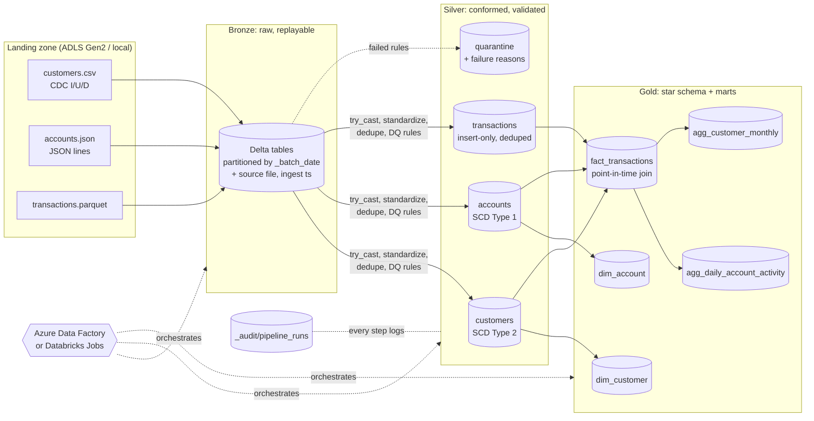

# Azure Lakehouse: Medallion Architecture for Banking Data

[](https://github.com/sumaksharikaa/azure-lakehouse-medallion-banking/actions/workflows/ci.yml)


This is a metadata-driven **Bronze → Silver → Gold lakehouse** built on **PySpark and Delta Lake**. It is designed
to run on **Azure Databricks over ADLS Gen2**, orchestrated by **Azure Data Factory**, and it runs on a laptop with no cloud account.

It processes daily retail-banking feeds (customers, accounts and card/ACH transactions) delivered as CSV, JSON
and Parquet. Along the way it handles the usual production problems: CDC deletes, duplicates, late-arriving records,
orphan keys, corrupt files and slowly changing customer attributes.

> **Note:** this is a personal portfolio project. All data is synthetic, produced by the included generator. No client code or data is used.

---

## Architecture



| Layer | What happens | Write strategy |
|---|---|---|
| **Bronze** | Files landed as delivered (CSV/JSON read as strings, so nothing is lost), plus `_source_file`, `_ingest_ts`, `_batch_date` | `replaceWhere` overwrite of the batch partition, so re-runs never duplicate rows |
| **Silver** | Schema conformance with `try_cast`, trimming/standardization, latest-record-per-key de-duplication, declarative DQ rules, quarantine | `MERGE`: SCD1 upsert (newer wins), insert-only for events, SCD2 staged-updates merge |
| **Gold** | Star schema with surrogate keys, point-in-time fact join, FX conversion, window-function aggregates | Full rebuild + `OPTIMIZE … ZORDER BY` |

## What it demonstrates

- **Metadata-driven ingestion.** Sources, schemas, keys, load strategy and data-quality rules all live in
  [`conf/pipeline.yaml`](conf/pipeline.yaml). Adding a source means adding config, not code.
- **CDC and SCD Type 2 in one atomic MERGE.** This uses the *staged updates* pattern ([`scd2.py`](src/lakehouse/scd2.py)).
  Unchanged re-sends are filtered out by a SHA-256 row hash, stale out-of-order changes are ignored,
  and CDC deletes become a new `is_deleted` version, so history is never lost.
- **Idempotent and safely re-runnable.** Every layer can be re-run for any batch date (ADF retries, back-fills)
  with identical results. This is covered by an integration test.
- **Data-quality framework** ([`quality.py`](src/lakehouse/quality.py)). Rule types are `not_null`, `regex`, `accepted_values`,
  `range`, `expression`, `is_null` (corrupt records) and `foreign_key` (broadcast join). Every failed rule is recorded per row, bad
  rows go to a quarantine table instead of failing the job, and per-rule failure counts go to the audit log.
- **Point-in-time correctness.** Each transaction joins to the customer version that was valid *when it happened*, so
  "spend by segment" is not distorted by later upgrades. Early-arriving facts resolve to the first version.
- **Late-arriving data.** SCD1 merges only overwrite when `source.updated_at >= target.updated_at`, and duplicate or
  re-delivered transactions are dropped by key.
- **Spark performance.** Broadcast joins for dimensions, partition-pruned MERGE conditions, AQE, caching of the DQ-checked
  frame, Z-ordering on `account_id`, and partitioning by `txn_date`.
- **Operational readiness.** A Delta audit table records rows in/out/quarantined, DQ failures, duration and errors for every step.
  There is also an ADF pipeline with retries and a failure alert, a Databricks Jobs definition, and CI on GitHub Actions.

## Results from a sample run

3 daily batches, ~15k transactions, generated with `make demo`:

| Check | Result |
|---|---|
| Transactions landed → silver (after dedup + DQ) | 15,208 → 15,000 unique |
| Rows quarantined, with reasons | customers 4, accounts 3, transactions 8 |
| Customer SCD2 versions | 626 total, 550 current, 76 historical, 4 CDC deletes |
| Current rows per customer | exactly 1 |
| Re-run of day 2 | silver row counts unchanged (idempotent) |
| `fact_transactions` vs silver | 15,000 = 15,000; every txn maps to a customer version |

Sample audit-log output:

```
silver customers    2026-11-02 SUCCEEDED  in=72    out=70    quarantined=2  {"customer_id_not_null": 1, "email_format": 2}
silver accounts     2026-11-02 SUCCEEDED  in=53    out=52    quarantined=1  {"account_id_not_null": 1, "customer_id_not_null": 1, "not_corrupt": 1}
silver transactions 2026-11-02 SUCCEEDED  in=5104  out=5100  quarantined=4  {"account_exists": 1, "amount_positive": 1, "currency_supported": 1, "txn_id_not_null": 1}
gold   all          2026-11-03 SUCCEEDED  in=15000 out=15000 quarantined=0  {}
```

## Quickstart (local)

Requirements: Python 3.10+ and Java 17. Delta Lake jars are downloaded automatically from Maven Central on first run.

```bash
git clone https://github.com/sumaksharikaa/azure-lakehouse-medallion-banking.git
cd azure-lakehouse-medallion-banking
python -m venv .venv && source .venv/bin/activate
make install        # pip install -e ".[local,dev]"
make demo           # generate 3 days of data and run Bronze -> Silver -> Gold
make test           # unit tests
make test-delta     # end-to-end tests on real Delta tables
```

Run a single day or a single layer, the same way ADF does:

```bash
python -m lakehouse.pipeline --batch-date 2026-11-02 --layers silver,gold
```

Explore the output with PySpark:

```python
from lakehouse.spark import get_spark

spark = get_spark()
spark.read.format("delta").load("data/lakehouse/gold/agg_customer_monthly").show()
spark.read.format("delta").load("data/lakehouse/_audit/pipeline_runs").show(truncate=False)
```

More queries, including time travel and `DESCRIBE HISTORY`, are in [`docs/sample_queries.sql`](docs/sample_queries.sql).

## Running on Azure

1. Build the wheel (`make wheel`) and upload it with `conf/pipeline.yaml` to DBFS or a Workspace folder.
2. Point the pipeline at ADLS Gen2: `--root abfss://lakehouse@<account>.dfs.core.windows.net`
   (or set `LAKEHOUSE_ROOT`). Grant the cluster access through a Unity Catalog external location or a
   service principal whose secret is kept in **Azure Key Vault**, never in code.
3. Orchestrate with either:
   - **ADF**: [`orchestration/adf/pl_lakehouse_daily.json`](orchestration/adf/pl_lakehouse_daily.json) runs three dependent
     Databricks activities with retries and a failure webhook, plus a daily trigger that passes yesterday's `batchDate`.
   - **Databricks Jobs**: [`orchestration/databricks/job_lakehouse_daily.json`](orchestration/databricks/job_lakehouse_daily.json).

On Databricks, `get_spark()` reuses the runtime's session, which already includes Delta.

## Project structure

```
├── conf/pipeline.yaml            # sources, schemas, keys, load types, DQ rules
├── data_generator/               # synthetic banking data with injected defects
├── src/lakehouse/
│   ├── bronze.py                 # raw ingestion + metadata
│   ├── silver.py                 # conform, standardize, dedupe (pure functions)
│   ├── quality.py                # declarative DQ rules + quarantine split
│   ├── scd2.py                   # change detection + staged updates for MERGE
│   ├── gold.py                   # star schema + aggregates
│   ├── delta_io.py               # all Delta reads/writes/MERGEs/OPTIMIZE
│   ├── pipeline.py               # orchestration, audit logging, CLI
│   └── spark.py / config.py
├── orchestration/adf/            # ADF pipeline + trigger
├── orchestration/databricks/     # Jobs API definition + launcher
├── tests/                        # pytest: unit + Delta end-to-end
└── docs/sample_queries.sql
```

## Design decisions

- **Business logic is kept apart from storage.** Every transformation is a pure DataFrame function, and only `delta_io.py` touches
  storage. Unit tests therefore run in seconds without Delta, and the integration suite covers the MERGE semantics.
- **Quarantine instead of failing.** One bad record should not block a whole day of banking data. Failures are visible
  in the quarantine table and the audit log, and can be alerted on with a threshold.
- **`try_cast` everywhere in silver.** Behaviour then stays the same whether the cluster runs with ANSI mode on or off.
  Unparseable values become nulls, which the `not_null` rules catch.
- **The gold layer is rebuilt in full.** This is fine at this scale and always consistent. At production volume the fact
  table would move to incremental `MERGE` or `replaceWhere` on affected `txn_date` partitions.

## Possible extensions

- Unity Catalog tables and column masking for PII (email, phone)
- Auto Loader (`cloudFiles`) for file-arrival-triggered ingestion
- Delta Live Tables expectations as an alternative DQ engine
- Terraform for the storage account, Databricks workspace and ADF

## License

MIT
